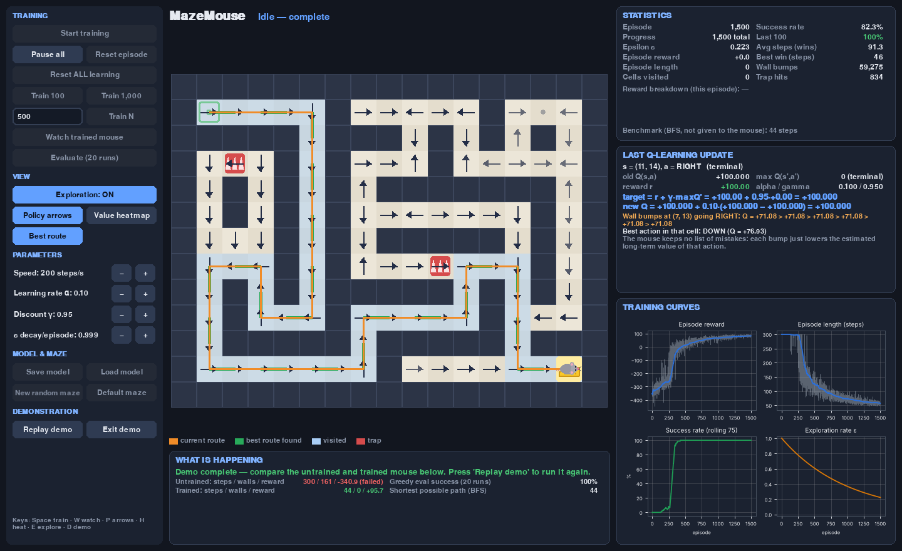
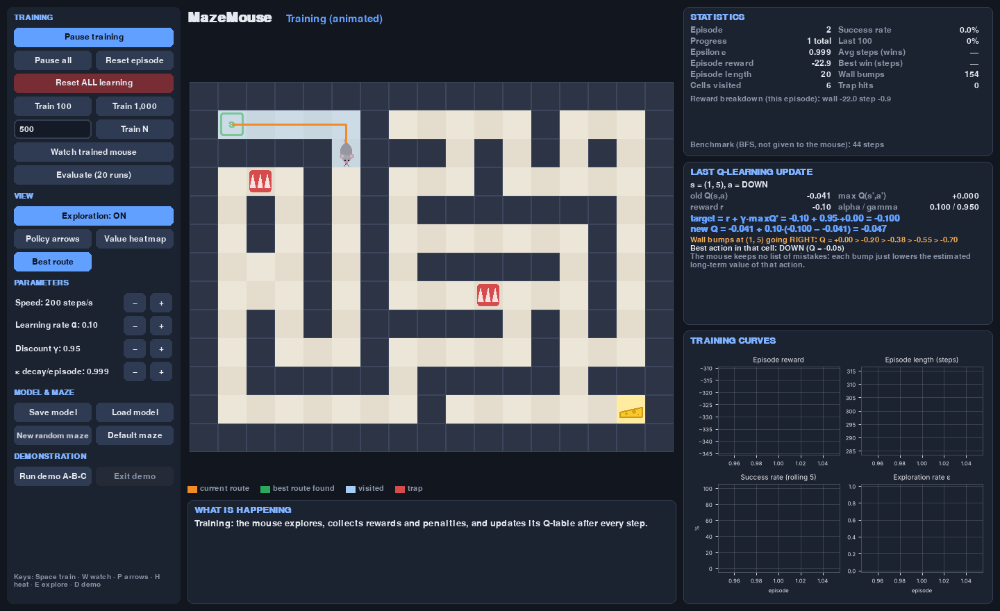
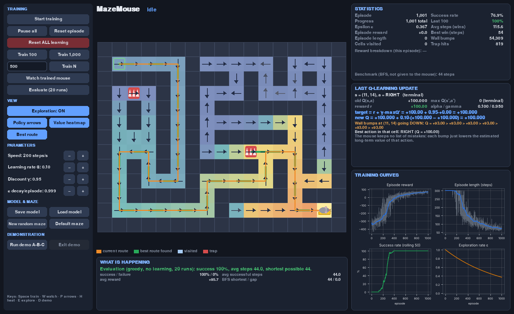
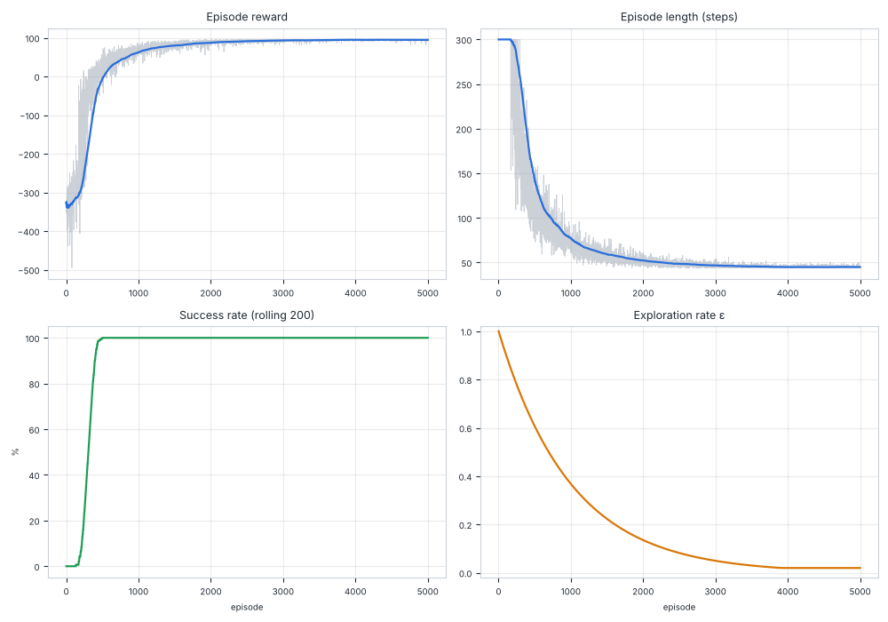

# MazeMouse — a mouse that learns from its mistakes

MazeMouse is a small interactive reinforcement learning lab. A mouse starts in a
maze knowing nothing. It bumps into walls, wanders into dead ends and steps on traps. From
the rewards and penalties it receives, it learns a policy that takes it to the cheese
along the shortest route.

The mouse learns with **tabular Q-learning written from scratch with NumPy**. It is
never given the maze layout, the goal position or a shortest path. Breadth-first search
(BFS) appears only in the evaluation code, as an independent benchmark.



---

## Contents

1. [Quick start](#quick-start)
2. [The interface](#the-interface)
3. [Command-line usage](#command-line-usage)
4. [How the mouse learns](#how-the-mouse-learns)
5. [Project layout](#project-layout)
6. [Results from a real run](#results-from-a-real-run)
7. [Testing](#testing)
8. [Troubleshooting](#troubleshooting)
9. [Known limitations](#known-limitations)

---

## Quick start

Requires **Python 3.11+**. Run these commands from the `mazemouse/` folder.

```bash
python -m venv .venv
```

Activate the virtual environment:

| OS | Command |
|----|---------|
| Windows (PowerShell) | `.venv\Scripts\Activate.ps1` |
| Windows (cmd.exe) | `.venv\Scripts\activate.bat` |
| macOS / Linux | `source .venv/bin/activate` |

Then:

```bash
pip install -r requirements.txt
python main.py
```

`python main.py` opens the interactive lab. To see the whole learning story at once,
click **Run demo A-B-C**.

---

## The interface

| Area | What it shows |
|------|---------------|
| **Left column** | All the controls: training, view toggles, hyper-parameters, model and maze, and the demo. |
| **Centre** | The maze. Dark cells are walls, cream cells are floor, the green **S** is the start, the red spiked cells are traps and the yellow wedge is the cheese. The mouse is drawn facing its last move and gets a red outline when it bumps a wall. Light blue marks cells visited in the current episode, the orange line is the current route, and the dashed green line is the shortest successful route found so far during training. |
| **What is happening** | A plain-language explanation of the current mode, demo stage, and evaluation or comparison results. |
| **Statistics** | Episode, progress, ε, current reward and length, cells visited, overall and last-100 success rate, average steps of successful episodes, best successful episode, total wall bumps and trap hits, the reward breakdown for the current episode, and the BFS benchmark. |
| **Last Q-learning update** | The real numbers behind the most recent update: old Q, reward, max next-state Q, α, γ, target, and new Q. It also shows how Q has changed across repeated bumps into the same wall. |
| **Training curves** | Matplotlib charts with rolling averages: reward, episode length, success rate and ε. They refresh every 1.5 s, not every frame. |

| Early training (random, many wall bumps) | Learned policy arrows plus value heatmap |
|---|---|
|  |  |

### Controls

| Button | Key | Action |
|--------|-----|--------|
| Start / Pause / Resume training | `Space` | Animated training at the chosen speed. At **turbo** speed, whole episodes run each frame. |
| Pause all | – | Freezes whatever is running: training, watching or the demo. |
| Reset episode | `R` | Puts the mouse back on the start and throws away the episode in progress. **The Q-table is kept.** |
| Reset ALL learning | – | **Erases the Q-table**, the visit counts, ε and all statistics. You must click twice to confirm. |
| Train 100 / Train 1,000 | `1` / `2` | Fast training for exactly that many episodes. The UI stays responsive. |
| Train N (with the number box) | – | Click the box, type a number, then click **Train N**. |
| Watch trained mouse | `W` | One greedy episode, animated, with **no learning**. |
| Evaluate (20 runs) | `V` | 20 greedy episodes with no learning, compared with the BFS benchmark. |
| Exploration: ON/OFF | `E` | ON uses ε-greedy. OFF always picks the best-known action (it still learns while training). |
| Policy arrows | `P` | Shows the arg-max action from the actual Q-table for each cell. |
| Value heatmap | `H` | Colours each explored cell by max_a Q(s,a). |
| Best route | `B` | Shows or hides the shortest successful route the mouse has actually walked. |
| Speed − / + | `-` / `+` | 1, 3, 8, 20, 60, 200 or 800 steps/s, or turbo. |
| Learning rate, discount, ε decay − / + | – | Change α, γ and the ε decay used from the next update or episode on. |
| Save model / Load model | `S` / `L` | Saves to or loads from `models/mouse.json`, or the path given with `--load`. |
| New random maze / Default maze | – | Switches maze. Learning starts from scratch. |
| Run demo A-B-C / Replay demo / Exit demo | `D` / `Esc` | Runs the three-stage demonstration in a separate, fresh session. |

### Demonstration mode (A → B → C)

The demo runs in a **fresh session**, so your own training is not touched. **Exit demo**
brings your session back.

* **Stage A, untrained mouse:** the Q-table is all zeros and the mouse moves at random.
  You see it bump walls and revisit dead ends, usually until the 300-step limit runs out.
* **Stage B, training:** two episodes are animated step by step. The Q-update panel shows
  wall bumps and wasted steps pushing values down, and the cheese reward spreading
  backwards. The demo then fast-forwards to 1,500 episodes while the charts update.
* **Stage C, learned mouse:** exploration is switched off and the policy arrows are
  shown. The mouse walks its learned route. A comparison table lists steps, wall bumps
  and reward for stage A versus stage C, together with the greedy success rate over 20
  runs and the BFS shortest path.

---

## Command-line usage

All commands run from the `mazemouse/` folder.

```bash
# Interactive GUI (same as `python main.py`)
python main.py gui
python main.py gui --load models/mouse.json     # continue from a saved model
python main.py gui --maze random --seed 3       # random maze

# Headless training. Saves the model, then runs a greedy evaluation.
python main.py train --episodes 5000 --seed 42 --save models/mouse.json --charts logs/charts.png

# Continue training a saved model for 2,000 more episodes
python main.py train --load models/mouse.json --episodes 2000 --save models/mouse.json

# Evaluate a saved model without learning
python main.py evaluate --load models/mouse.json --episodes 50
python main.py evaluate --load models/mouse.json --json

# Run the tests
python -m pytest
```

Common options for every command:

| Option | Meaning |
|--------|---------|
| `--config FILE` | A JSON config file. See `config.json` for every key. |
| `--maze default\|small\|random\|FILE` | Picks the maze. `FILE` is a JSON file containing `{"layout": ["#####", "#S.G#", "#####"]}`. |
| `--seed N` | Random seed for the agent and for random mazes. `-1` means no seed. |
| `--max-steps N` | Step limit per episode. |
| `--load FILE` | Load a saved model first. Training continues from its episode count and ε. |
| `-v` | Verbose (debug) logging. |

`train` also accepts `--episodes`, `--alpha`, `--gamma`, `--epsilon-decay`, `--save`,
`--charts`, `--log-every` and `--eval-episodes`.

Logs are written to the console and to `logs/mazemouse.log`.

### Configuration

`config.json` holds every default and is validated when loaded. Unknown keys and
out-of-range values are rejected with a clear error. You can change rewards or
hyper-parameters without editing any code:

```json
{
  "rewards":     {"goal": 100.0, "step": -0.1, "wall": -2.0, "trap": -10.0, "timeout": -5.0},
  "environment": {"max_steps": 300, "maze": "default", "trap_terminates": false, "...": "..."},
  "agent":       {"learning_rate": 0.1, "discount": 0.95, "epsilon_start": 1.0,
                  "epsilon_min": 0.02, "epsilon_decay": 0.999, "decay_mode": "episode"},
  "training":    {"episodes": 5000, "seed": 42, "eval_episodes": 20}
}
```

### Saving and loading models

A model file (JSON, `"format": "mazemouse-qtable", "version": 1`) stores:

* the Q-table and the per-action visit counts,
* the maze layout,
* the learning parameters and ε,
* the episode count,
* the reward and environment settings,
* every training episode's statistics,
* the seed and the exact NumPy RNG state.

Because the RNG state is saved, *train 40 → save → load → train 40* gives the same
Q-table as training 80 episodes in one go (`tests/test_persistence.py` checks this).
The loader validates the format, version, Q-table shape, finite values, the ranges of
every parameter and the maze, and reports a readable error instead of crashing.

---

## How the mouse learns

### The problem as an MDP

* **State:** the mouse's cell, `(row, column)`. The maze is deterministic and the goal
  never moves, so the position is enough to act optimally. Richer environments (moving
  cheese, partial observability, keys and doors) would need more information in the state.
* **Actions:** `UP=0, RIGHT=1, DOWN=2, LEFT=3`. A move into a wall leaves the mouse where
  it is and costs the wall penalty.
* **Episode end:**
  * *terminated*: the mouse reached the cheese. This is a true terminal state of the MDP,
    and so is a trap if `trap_terminates` is true.
  * *truncated*: the step limit ran out. The mouse is *not* in a terminal state, the
    episode was just cut short.

### Rewards and penalties

| Event | Reward | Why |
|-------|--------|-----|
| Reach the cheese | **+100** | Makes finishing worth far more than anything else. |
| Valid move | **−0.1** | A small cost per step, so shorter routes are worth more. |
| Bump into a wall | **−2** | Teaches the mouse that this action is useless here. |
| Enter a trap | **−10** | A dangerous cell, which the learned route avoids. |
| Hit the step limit | **−5** | Added on the last step of an episode that ran out of time. |

There are no positive rewards along the way, so the mouse gains nothing by wandering.
Each component is tracked separately, and the dashboard shows the breakdown, for example
`wall −22.0  step −0.9`.

### The Q-table and the update

`Q[r, c, a]` estimates the total discounted reward of taking action `a` in cell `(r, c)`
and then acting well afterwards. It starts at zero. After every transition
`(s, a, r, s')`:

```
target   = r + γ · max_a' Q(s', a')        (non-terminal transitions)
target   = r                              (terminal: the cheese has no future)
Q(s, a) ← Q(s, a) + α · (target − Q(s, a))
```

(`agent/q_learning.py:update_q_value`). Truncated transitions still *bootstrap*, because
running out of time does not make a state worthless.

**Learning from mistakes:** when the mouse bumps the same wall again, the update keeps
lowering that action's Q-value towards `−2 + γ·V(s)`. Meanwhile the useful actions in
that cell rise as cheese value flows back to them. The mouse keeps no list of
mistakes; it just changes its estimate of each action's long-term value. The **Last
Q-learning update** panel shows this with the real numbers from training.

**How success spreads backwards:** the first time the mouse reaches the cheese, only
the last action gets +100. On later visits, the cell before it sees a high
`max Q(s')` and its value rises too. Over many episodes the value spreads back to the
start. Turn on the heatmap to watch this happen.

### ε-greedy exploration

With probability ε the mouse picks a random action; otherwise it picks the action with
the highest Q-value. If several actions tie for the highest value, it picks one of them
at random, which avoids a built-in bias towards UP. ε starts at 1.0 (fully random) and
is multiplied by `epsilon_decay` after each episode (or each step, if `decay_mode` is
`"step"`), down to `epsilon_min = 0.02`. With the default 0.999 decay, ε reaches the
minimum after roughly 3,900 episodes. That is slow enough for the mouse to find the
cheese many times before it starts mostly exploiting.

### Policy and heatmap visualisation

* **Arrows** show the arg-max of the actual Q-table in each cell. A cell gets a grey dot
  instead when it has never been updated, when its best action is tied, or when its best
  action has never been tried. Faint arrows mean the best action has been tried only a
  few times; solid arrows mean it has been tried 15 or more times.
* **The heatmap** colours each explored cell by `max_a Q(s,a)`, from blue (low) to
  orange (high). Cells never explored stay uncoloured.

### Evaluation

`training/evaluation.py` runs greedy episodes (ties broken at random) with **no
updates**. It never changes the Q-table, visit counts, ε, the agent's RNG or the training
statistics, and the tests check all of these. It reports the success and failure rate,
the average reward, the average steps, the BFS shortest path and the gap between the
mouse's routes and that benchmark. The BFS path is used **only** for this comparison.

---

## Project layout

```
mazemouse/
├── main.py                 CLI entry point (gui / train / evaluate)
├── config.py               validated dataclass config, JSON load/save
├── config.json             default configuration
├── session.py              wires maze + env + agent + trainer (used by CLI and GUI)
├── requirements.txt
├── environment/
│   ├── maze.py             Maze, MazeEnv (reset/step), StepInfo, BFS benchmark
│   └── generator.py        seeded random maze generation (backtracker + loops + traps)
├── agent/
│   ├── q_learning.py       QLearningAgent: choose_action, update_q_value, decay
│   └── persistence.py      JSON model save/load with validation
├── training/
│   ├── trainer.py          Trainer: step, train_episode, train, run_episode
│   ├── evaluation.py       evaluate_agent (no learning), EvaluationReport
│   └── metrics.py          EpisodeStats, MetricsTracker, rolling_mean
├── visualization/
│   ├── app.py              Pygame main loop, modes, demo state machine
│   ├── renderer.py         maze, mouse, cheese, routes, policy arrows, heatmap
│   ├── dashboard.py        stats panel, Q-update explanation, chart panel
│   ├── charts.py           Matplotlib figures (Agg; also used headless)
│   ├── controls.py         Button and NumberField widgets
│   └── theme.py            colours and fonts
├── tests/                  pytest suite (84 tests)
├── docs/                   screenshots and the training chart from a real run
├── models/                 saved models (git-ignored)
└── logs/                   log files (git-ignored)
```

The learning code (`environment`, `agent`, `training`) never imports Pygame, so
training runs headless. The GUI runs on a **single thread**: each frame it trains for at
most about 25 ms, then draws, and `clock.tick` sleeps until the next frame. Because no
other thread exists, no state is shared between threads.

---

## Results from a real run

The command `python main.py train --episodes 5000 --seed 42 --eval-episodes 50 ...`
was run on the default 13×17 maze (2 traps, several loops, BFS shortest path 44 steps).

| Episodes | ε | Success (last 500) | Avg steps (last 500) | Best so far |
|---------:|------:|------:|------:|----:|
| 500  | 0.606 | 58.8%  | 219.5 | 77 |
| 1000 | 0.368 | 100%   | 89.0  | 57 |
| 2000 | 0.135 | 100%   | 54.2  | 44 |
| 3000 | 0.050 | 100%   | 47.2  | 44 |
| 5000 | 0.020 | 100%   | 45.0  | 44 |

Training took about 4.5 s. The greedy evaluation over 50 runs, with no learning:

| | Untrained (zero Q-table) | Trained (5,000 episodes) |
|--|--|--|
| Success rate | 0% | **100%** |
| Average steps | 300 (always times out) | **44.0** |
| Average reward | −336.9 | **+95.7** |
| BFS shortest path | 44 | 44 |
| Gap to shortest | – | **+0.0 steps** |



A random 11×15 maze (`--maze random --seed 7`) also converged to its BFS optimum of 24
steps, with 100% greedy success.

---

## Testing

```bash
python -m pytest            # 84 tests, about 6 s
```

* **`test_maze.py`**: the start position; walls block movement and cost −2; a valid move
  costs −0.1; the cheese terminates the episode; the step limit truncates it (with the
  timeout penalty, and never on the same step as the goal); traps; invalid layouts are
  rejected; the default maze has dead ends, loops and traps; the BFS path is valid;
  generated mazes are solvable and reproducible from a seed.
* **`test_q_learning.py`**: the exact non-terminal formula; terminal updates do not
  bootstrap; repeated wall bumps lower Q; exploit (ε=0), explore (ε=1, uniform) and
  mixed (ε=0.2, about 85% best); random tie-breaking among the best actions only; the
  ε floor; seed reproducibility; config validation.
* **`test_training.py`**: episode statistics are consistent; the Q-table changes;
  step-by-step training matches whole-episode training; evaluation and watch mode leave
  Q, ε, the RNG and the metrics unchanged; **convergence** on the small maze (optimal
  path) and on the **default maze with default parameters** (100% greedy success, within
  4 steps of BFS after 3,000 episodes, late episodes less than half the length of early
  ones); seeded runs are reproducible.
* **`test_persistence.py`**: round trip; continuing training matches an uninterrupted
  run; 8 kinds of corrupted file are rejected; missing or invalid JSON files; config
  files.
* **`test_gui_actions.py`** (dummy SDL display): every button has a handler; Train
  100/N train exactly that many episodes; start, pause and resume; reset episode versus
  reset all; watch and evaluate do not learn; toggles and parameter buttons; save then
  load restores the Q-table; the demo goes through stages A → B → C and restores your
  session.

---

## Troubleshooting

| Problem | Fix |
|---------|-----|
| `ModuleNotFoundError: pygame` | Activate the virtual environment and run `pip install -r requirements.txt`. |
| `ModuleNotFoundError: config` / `environment` | Run commands from inside the `mazemouse/` folder. |
| No display (SSH, CI, container) | Use `python main.py train` and `evaluate`, which never open a window. To run the GUI without a display: `SDL_VIDEODRIVER=dummy`. |
| `Could not load model: ...` | The file is missing, corrupt, from another version, or its Q-table does not match the maze. The message says which. |
| The mouse never finds the cheese | Check that ε is not decaying too fast (raise `epsilon_decay`), that `max_steps` is big enough for the maze, and that the step penalty is not positive. Then look at the success-rate chart. |
| The window is too small | It can be resized (minimum 1100×720), and the maze rescales. |

---

## Known limitations

* The state is only the mouse's position, so the agent is tied to one fixed maze. A new
  or changed maze needs new training, and the GUI's maze buttons reset learning.
* Tabular Q-learning scales with the number of cells × 4. Large mazes need more episodes
  and slower ε decay; continuous or huge spaces would need function approximation.
* The BFS benchmark treats traps as passable. If the only shortest route crossed a trap,
  the mouse's best route could legitimately be longer than the benchmark. This does not
  happen in the default maze.
* The GUI always saves to and loads from a single model path (`models/mouse.json`, or
  the `--load` path). Use the CLI to manage several model files.
* GUI text uses Pygame's built-in font, so some Unicode symbols are written in ASCII.
* GUI behaviour is checked with a headless (dummy SDL) test suite and screenshots; the
  look on each OS's native window system was not checked by hand.
